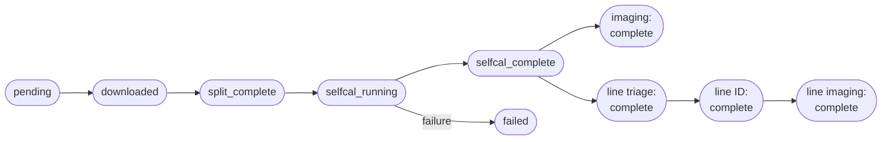

# ALMA-SAILS Pipeline

**ALMA-SAILS** is a Python-based data processing pipeline for ALMA interferometric surveys of star-forming regions. It automates the journey from raw calibrated data in the ALMA archive to science-ready continuum images and spectral line cubes.

This documentation is written for anyone running the pipeline on their own project — whether that is the Serpens protostar survey for which it was originally built, or a new region entirely.

---

## What the pipeline does

Starting from an ALMA calibrated Measurement Set (downloaded from the archive), the pipeline carries each observation through six stages:

| Stage | What happens |
|---|---|
| **Download** | Retrieves the calibrated MS from the SRDP archive |
| **Split** | Extracts target-only spectral windows into a compact MS |
| **Self-calibration** | Runs `auto_selfcal` (PHANGS-derived) to correct residual phase errors |
| **Continuum imaging** | Runs `tclean` + primary-beam correction + FITS export |
| **Line triage** | Makes dirty cubes of line-candidate SPWs for automated line identification |
| **Line identification** | Runs ADMIT to identify spectral lines and writes detections to the database |
| **Deep line imaging** | Produces fully-cleaned images of confirmed line detections |

---

## A note on platform

The pipeline was developed on the [CANFAR](https://www.canfar.net) science platform, but the **processing scripts are platform-agnostic** — they run in any CASA 6 environment and write all state to a local SQLite database. The Prefect orchestration layer (automated scheduling, headless job submission) is CANFAR-specific and not required to run the pipeline manually.

This tutorial focuses on the manual script interface, which works identically on a laptop, a cluster, or a cloud VM.

---

## Quick links

- [Getting Started](getting-started.md) — directory layout, prerequisites, and your first database query
- [Tutorial](tutorial/index.md) — walk through all seven stages with a real MOUS
- [Script Reference](reference/scripts.md) — complete table of all scripts and their arguments
- [Database Schema](reference/database.md) — all tables, columns, and FSM state machines
