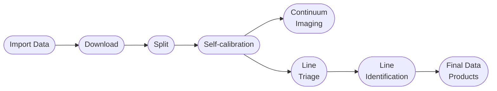

# ALMA-SAILS Pipeline

This codebase is a Python-based data processing pipeline developed for the ALMA-SAILS project — an ALMA survey of protostellar sources in the Serpens star-forming region.

This is one student's approach to learning how to develop tools that integrate all aspects of a data analysis pipeline. Many of the choices made come from wanting to learn new tools and packages; this includes SQLite for a database-centric workflow, along with Prefect for task orchestration. The pipeline was built by writing all base pipeline tasks as scripts, then wrapping a higher-level orchestration layer on top — allowing the flexibility of running things manually through the CLI, or in an almost-fully automated fashion with Prefect.

---

## A note on platform

The pipeline was developed on the [CANFAR](https://www.canfar.net) science platform, but the **processing scripts are platform-agnostic** — they run in any CASA 6 environment and write all state to a local SQLite database. The Prefect orchestration layer (automated scheduling, headless job submission) is CANFAR-specific and not required to run the pipeline manually.

This documentation focuses on the manual script interface, which works identically on a laptop, a cluster, or a cloud VM.

---

## What the pipeline does

Starting from an ALMA calibrated Measurement Set (downloaded from the archive), the pipeline carries each observation through seven stages:

| Stage | What happens |
|---|---|
| **Download** | Retrieves the calibrated MS from the SRDP archive |
| **Split** | Extracts target-only spectral windows into a compact MS |
| **Self-calibration** | Runs `auto_selfcal` to correct residual phase errors |
| **Continuum imaging** | Runs `tclean` + primary-beam correction + FITS export |
| **Line triage** | Makes dirty cubes of line-candidate SPWs for automated line identification |
| **Line identification** | Runs ADMIT to identify spectral lines and writes detections to the database |
| **Deep line imaging** | Produces fully-cleaned images of confirmed line detections |

---

## Quick links

- [Getting Started](getting-started.md) — directory layout, prerequisites, and your first database query
- [Tutorial](tutorial/index.md) — walk through all seven stages with a real MOUS
- [Script Reference](reference/scripts.md) — complete table of all scripts and their arguments
- [Database Schema](reference/database.md) — all tables, columns, and FSM state machines
