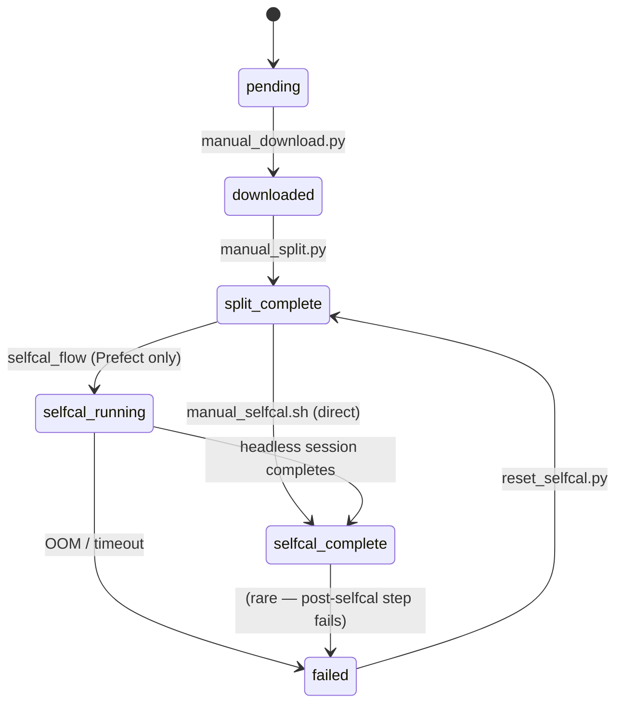
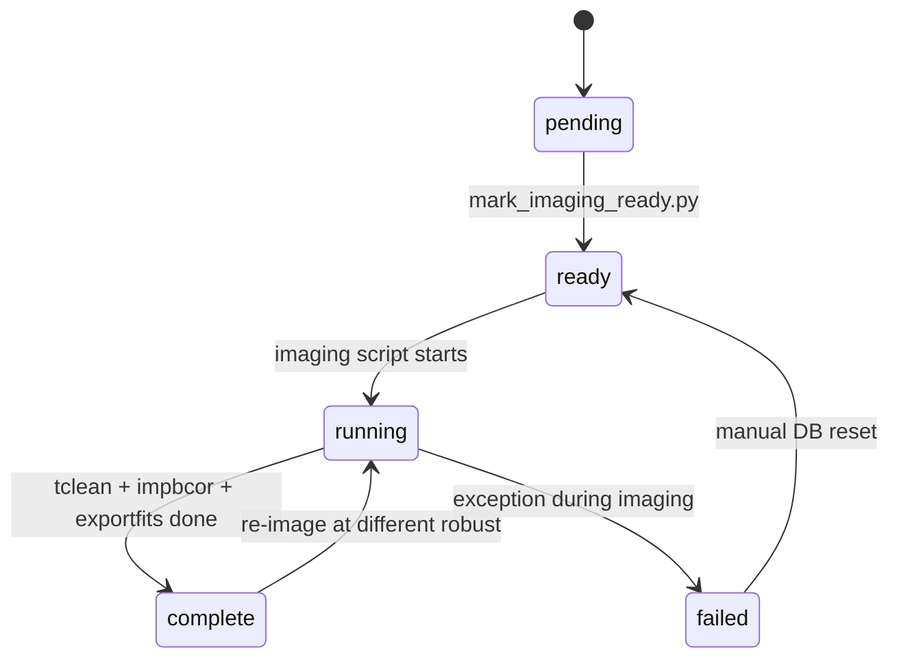

# Pipeline States Reference

The pipeline uses several independent finite-state machines (FSMs), one per processing track. Each FSM is stored as a `current_state` column in the relevant database table.

---

## MOUS FSM (`pipeline_state`)

Tracks each MOUS from archive download through self-calibration.

| State | Description |
|---|---|
| `pending` | Initial state; no data downloaded yet |
| `downloaded` | Calibrated MS retrieved; `mous_directory` set in DB |
| `split_complete` | Target-only MSes extracted; `split_products` set in DB |
| `selfcal_running` | Selfcal session submitted (Prefect path only) |
| `selfcal_complete` | Selfcal finished; `selfcal_products` and `selfcal_products_sub` set |
| `failed` | Terminal failure; `failure_count` incremented |

---

## Imaging FSM (`imaging_pipeline_state`)

One row per `(source, band, config_type)` group.

| State | Description |
|---|---|
| `pending` | Unit exists but contributing MOUSes are not all selfcal-complete |
| `ready` | All contributing MOUSes at `selfcal_complete`; imaging can start |
| `running` | tclean in progress |
| `complete` | At least one imaging product written; `imaging_products` JSON array populated |
| `failed` | Exception during imaging |

---

## Line Triage FSM (`line_triage_pipeline_state`)

One row per `(mous_id, source, spw_index)`. Rows are created dynamically when the headless session (or manual script) classifies SPWs from `cont.dat`.

| State | Description |
|---|---|
| `ready` | SPW classified as a line candidate; dirty cube not yet made |
| `running` | tclean in progress |
| `complete` | Dirty FITS cube written |
| `failed` | tclean failed (commonly OOM) |

---

## Line Admit FSM (`line_admit_pipeline_state`)

One row per `line_triage_unit_id` (1:1 mapping). Rows are created on first run.

| State | Description |
|---|---|
| `ready` | Parent triage unit is `complete`; ADMIT not yet run |
| `running` | ADMIT in progress |
| `complete` | ADMIT finished; detections written to `line_admit_detection` |
| `failed` | ADMIT raised an exception |

Line detections additionally carry their own `review_status`:

| `review_status` | Description |
|---|---|
| `pending` | Awaiting human review |
| `confirmed` | Confirmed as real; eligible for deep line imaging |
| `rejected` | Marked as false positive; excluded from deep imaging |

---

## Line Imaging FSM (`line_imaging_pipeline_state`)

One row per confirmed `line_admit_detection_id` (1:1 mapping).

| State | Description |
|---|---|
| `ready` | Detection confirmed; deep cube not yet made |
| `running` | tclean in progress |
| `complete` | Cleaned FITS cube written; `imaging_products` populated |
| `failed` | tclean failed |
