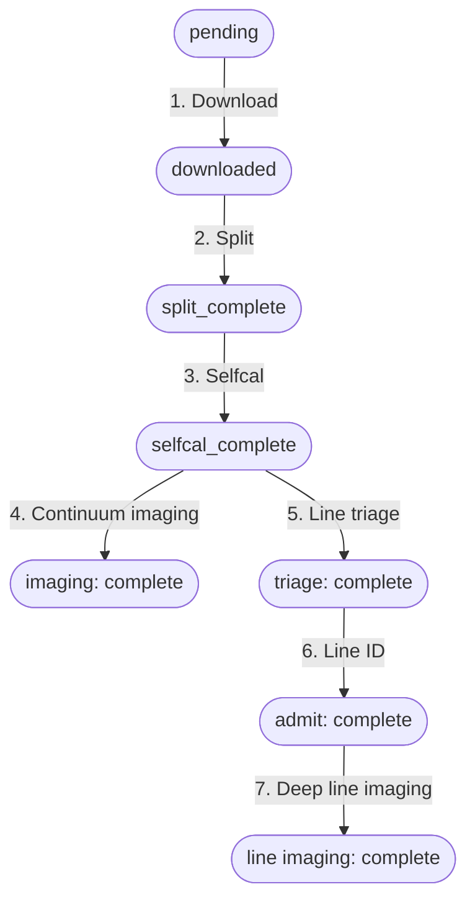

# Tutorial Overview

This tutorial walks a single ALMA observation through the complete pipeline — from a raw calibrated measurement set in the archive to science-ready continuum images and spectral line cubes.

---

## Conventions used in this tutorial

Throughout the pages that follow, we use these placeholder names. Substitute your own values wherever you see them:

| Placeholder | What it represents | Serpens survey value |
|---|---|---|
| `<project-root>` | Top-level project directory | `ALMA-SAILS/` |
| `<survey>.db` | SQLite database file | `serpens_v2.db` |
| `<mous-id>` | ALMA Measurement-Set UID | `uid://A001/X1234/X5678` |
| `<source>` | Science target name | `EC_53` |
| `<band>` | ALMA frequency band number | `6` |
| `<config>` | Array configuration type | `12m`, `7m`, or `tp` |

All scripts are run from `<project-root>`. The codebase lives at `<project-root>/alma-sails-codebase/`.

!!! tip "Serpens quick reference"
    For the Serpens survey, `<project-root>` is the `ALMA-SAILS/` directory,
    the database is `db/serpens_v2.db`, and sources are named things like
    `EC_53`, `Per-emb-2`, `Ser-emb-1`.

---

## Two ways to run each pipeline stage

Almost every pipeline stage can be invoked in one of two ways:

**Manual — any CASA environment**
: Run the processing script directly inside any CASA 6 environment (a container, a local CASA installation, or a cloud VM). This is the portable path and the one demonstrated most throughout this tutorial.

**Automated — Prefect + CANFAR**
: Trigger a Prefect flow, which submits a CANFAR headless session. The session runs the same underlying script and writes results back to the database. This is how the Serpens survey runs in production.

Both paths read from and write to the same SQLite database. You can mix them freely — using Prefect for routine bulk runs but falling back to manual scripts when debugging a specific MOUS.

Each tutorial page shows both methods in tabbed sections. If you are not using CANFAR, follow the **Manual** tab throughout.

---

## What you will do

Each step corresponds to a state transition in the database:



| Step | Page | Start state | End state |
|------|------|-------------|-----------|
| 1 | [Download](01_download.md) | `pending` | `downloaded` |
| 2 | [Split](02_split.md) | `downloaded` | `split_complete` |
| 3 | [Self-calibration](03_selfcal.md) | `split_complete` | `selfcal_complete` |
| 4 | [Continuum imaging](04_imaging.md) | imaging `ready` | imaging `complete` |
| 5 | [Line triage](05_line_triage.md) | `selfcal_complete` | triage `complete` |
| 6 | [Line identification](06_admit.md) | triage `complete` | admit `complete` |
| 7 | [Deep line imaging](07_line_imaging.md) | detection `confirmed` | line imaging `complete` |

Steps 4 through 7 branch in parallel once a MOUS reaches `selfcal_complete`.

---

## Before you start

- You have read [Getting Started](../getting-started.md)
- The database is seeded and at least one MOUS is in `pending` state
- You know the MOUS UID you want to process

Find a pending MOUS:

```bash
sqlite3 db/<survey>.db \
  "SELECT ps.mous_id, m.band, m.array_config
   FROM pipeline_state ps
   JOIN mous m USING (mous_id)
   WHERE ps.current_state = 'pending'
   LIMIT 5;"
```
